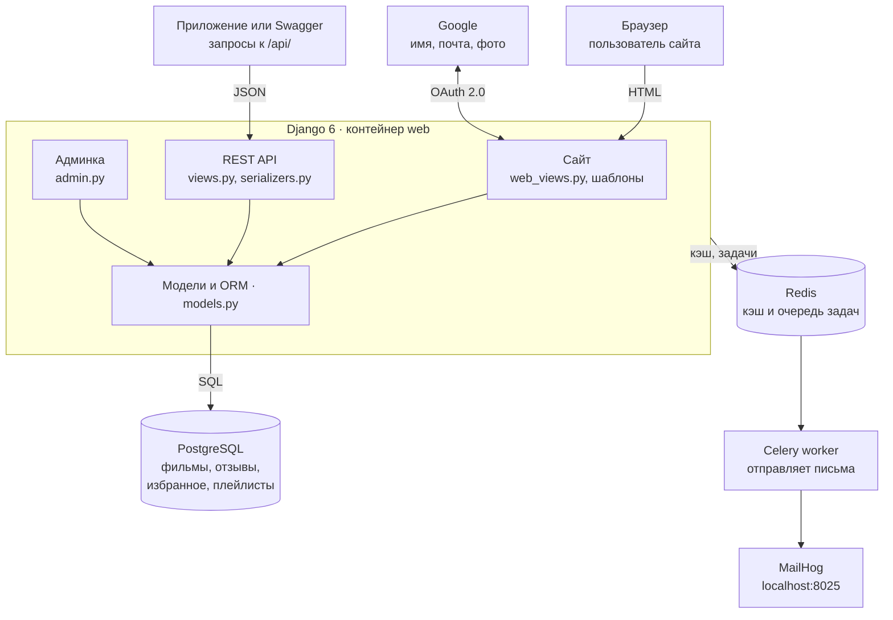

# Cinema — пояснения к курсовой

13.10.2026 · Nicola

Cinema — веб-приложение онлайн-кинотеатра на Django 6 и Django REST Framework. Пользователь смотрит каталог фильмов, ищет и фильтрует их, оставляет отзывы с оценкой, добавляет фильмы в избранное и плейлисты. Войти можно по логину и паролю или через Google. У проекта два интерфейса: HTML-сайт для людей и REST API для программ. Оба работают с одной базой PostgreSQL.

## Архитектура



В центре — один Django-сервер. У него три входа: сайт для людей, API для программ и админка. Все три работают с базой через одни и те же модели. Долгая работа, отправка писем, уходит через очередь Redis в отдельный процесс Celery. Каждый сервис в Docker запущен в своём контейнере.

## Структура проекта

Проект состоит из двух Django-частей. `core` — настройки всего проекта. `cinema` — приложение с логикой кинотеатра.

| Файл или папка | Зачем нужен |
| --- | --- |
| `manage.py` | Точка входа для команд Django: `runserver`, `migrate`, `test`, `seed_db` |
| `core/settings.py` | Все настройки: приложения, база, кэш, Celery, почта, вход через Google. Читает секреты из `.env` |
| `core/urls.py` | Главная карта адресов: `/admin/`, `/api/`, `/api/docs/`, `/accounts/`, сайт на `/` |
| `core/celery.py` | Создаёт Celery-приложение и находит задачи в `tasks.py` |
| `cinema/models.py` | Модели базы данных: фильм, категория, отзыв, избранное, плейлист |
| `cinema/migrations/` | Миграции — история изменений структуры таблиц |
| `cinema/serializers.py` | Превращают модели в JSON и проверяют входящие данные API |
| `cinema/views.py` | Логика REST API: ViewSet-ы для фильмов, отзывов, избранного, плейлистов |
| `cinema/urls.py` | Router, который строит адреса API из ViewSet-ов |
| `cinema/web_views.py` | Логика HTML-страниц сайта |
| `cinema/web_urls.py` | Адреса страниц сайта |
| `cinema/forms.py` | Формы сайта: отзыв и регистрация, с проверками |
| `cinema/permissions.py` | Свои правила доступа: «админ или автор», «только админ меняет», «только владелец» |
| `cinema/filters.py` | Фильтры списка фильмов: по категории, году, рейтингу |
| `cinema/cache.py`, `cinema/signals.py` | Кэш списка фильмов и его сброс при изменении данных |
| `cinema/tasks.py` | Фоновая задача Celery: письмо «Спасибо за отзыв» |
| `cinema/context_processors.py` | Передаёт во все шаблоны признак, включён ли вход через Google |
| `cinema/templatetags/cinema_extras.py` | Свои теги шаблонов: аватар, имя пользователя |
| `cinema/templates/cinema/` | HTML-шаблоны страниц |
| `cinema/templates/allauth/` | Служебные страницы allauth в дизайне сайта |
| `cinema/static/cinema/css/style.css` | Стили сайта |
| `cinema/admin.py` | Настройка админки |
| `cinema/management/commands/seed_db.py` | Команда заполнения базы тестовыми данными |
| `cinema/tests.py` | Автотесты, 30 штук |
| `Dockerfile`, `docker-compose.yml` | Сборка и запуск всех сервисов в контейнерах |
| `.env` | Секреты и настройки окружения. В Git не попадает |
| `requirements.txt` | Список Python-библиотек с версиями |
| `run_local.bat` | Запуск без Docker на Windows |

## База данных

В базе пять своих таблиц и стандартная таблица пользователей Django `User`. Таблицы описаны классами-моделями в `cinema/models.py`. SQL вручную не пишется: Django ORM сам строит запросы, а миграции создают таблицы.

| Модель | Поля | Связи | Ограничения |
| --- | --- | --- | --- |
| `Category` — категория | `name` | Одна категория → много фильмов | Название уникально |
| `Movie` — фильм | `title`, `description`, `release_year`, `duration_minutes`, `views_count` | `category` — ForeignKey на `Category` | Пара «название + год» уникальна. Год от 1895 до 2100 |
| `Review` — отзыв | `text`, `rating` (1–10), `created_at` | ForeignKey на `Movie` и на `User` | Один отзыв от пользователя на фильм |
| `Favorite` — избранное | — | ForeignKey на `User` и на `Movie` | Один фильм в избранном один раз |
| `Playlist` — плейлист | `name` | ForeignKey на `User`, ManyToMany на `Movie` | — |

Типы связей:

- **ForeignKey (один ко многим).** У фильма одна категория, у категории много фильмов. В таблице фильма хранится `category_id`.
- **ManyToMany (многие ко многим).** В плейлисте много фильмов, и фильм может быть во многих плейлистах. Django сам создаёт промежуточную таблицу.
- **`Favorite` — явная промежуточная таблица** между пользователем и фильмом. По сути это тоже «многие ко многим».

Поведение при удалении (`on_delete`):

- Удалили категорию — у её фильмов категория становится пустой (`SET_NULL`). Фильмы остаются.
- Удалили фильм или пользователя — его отзывы и избранное удаляются вместе с ним (`CASCADE`).

Проверки работают на двух уровнях. `UniqueConstraint` запрещает дубли прямо в базе. Валидаторы и метод `clean()` дают понятную ошибку ещё до записи.

На сайте и в Docker используется PostgreSQL 14. Без Docker проект переходит на SQLite. Код при этом не меняется: разницу скрывает ORM.

## Путь запроса

Django работает по схеме MVT: Model — View — Template. Любой запрос проходит одни и те же шаги. Пример: пользователь открывает `/movies/5/`.

1. **Браузер** отправляет GET-запрос на сервер.
2. **Middleware** обрабатывает запрос до view: восстанавливает сессию, определяет пользователя, проверяет CSRF-токен для POST.
3. **URL-роутинг.** `core/urls.py` передаёт адрес в `cinema/web_urls.py`. Там `movies/<int:pk>/` связан с функцией `movie_detail`, `pk = 5`.
4. **View** (`web_views.movie_detail`) увеличивает счётчик просмотров и забирает фильм с отзывами.
5. **Model / ORM** превращает это в SQL-запросы к PostgreSQL и возвращает Python-объекты.
6. **Template** (`detail.html`) подставляет данные в HTML.
7. **Ответ** уходит в браузер. Браузер догружает `style.css`.

Запрос к API, например `GET /api/movies/5/`, идёт почти так же. Разница в трёх местах:

- вместо функции работает ViewSet `MovieViewSet`;
- перед действием проверяются права из `permissions.py`;
- вместо шаблона сериализатор превращает объект в JSON.

При записи (POST) сериализатор сначала проверяет данные. При ошибке клиент получает код 400 и описание ошибки, и в базу ничего не попадает.

## Модули сайта

Сайт состоит из девяти модулей. Ниже для каждого: зачем он нужен, как работает и где лежит код. Все HTML-страницы собираются на сервере шаблонами Django и наследуются от `base.html` — общего каркаса с шапкой и подвалом.

### 1. Каталог фильмов — `/`

**Зачем.** Главная страница. Показывает все фильмы карточками и помогает найти нужный.

**Как работает.**

- Функция `index` берёт фильмы через `movies_with_stats`. Эта функция сразу считает в базе средний рейтинг, число отзывов и признак «в избранном».
- Поиск `?q=` ищет по названию и описанию через `Q(...) | Q(...)`, то есть логическое «или».
- Фильтр `?category=` оставляет одну категорию.
- Сортировка `?sort=`: популярные, по рейтингу, новые, по названию.
- `Paginator` делит список на страницы по 12 фильмов.

**Где.** `web_views.index`, `templates/cinema/index.html`, `_movie_card.html`.

### 2. Страница фильма — `/movies/<id>/`

**Зачем.** Показать всё о фильме: описание, категорию, длительность, рейтинг, число просмотров и отзывы.

**Как работает.**

- При каждом открытии счётчик просмотров растёт на 1. Для этого используется `F('views_count') + 1`. Сложение выполняет сама база, одним SQL-запросом. Два одновременных просмотра не потеряются.
- Отзывы загружаются вместе с авторами и их Google-аккаунтами заранее. Так для аватарок не нужен отдельный запрос на каждый отзыв.

**Где.** `web_views.movie_detail`, `templates/cinema/detail.html`.

### 3. Отзывы

**Зачем.** Пользователи ставят фильму оценку от 1 до 10 и пишут текст. Из оценок считается средний рейтинг фильма.

**Как работает.**

1. Форма видна только вошедшему пользователю, который ещё не оценил этот фильм.
2. `ReviewForm` проверяет текст на запрещённые слова. Используется регулярное выражение, поэтому ловятся и формы слова: «идиот», «идиоты».
3. Отзыв сохраняется с текущим пользователем как автором. Подменить автора из формы нельзя.
4. Celery в фоне отправляет автору письмо «Спасибо за отзыв». Страница не ждёт отправки.
5. После отправки идёт перенаправление на ту же страницу. Это паттерн Post/Redirect/Get: обновление страницы не отправит отзыв повторно.

Один отзыв на фильм от пользователя гарантирует ограничение в базе. Обойти его через API тоже нельзя.

**Где.** `forms.ReviewForm`, `serializers.contains_forbidden_words`, `tasks.send_thank_you_email`.

### 4. Избранное — `/favorites/`

**Зачем.** Личный список фильмов, которые пользователь хочет запомнить.

**Как работает.** Кнопка на странице фильма отправляет POST на `toggle_favorite`. Функция делает `get_or_create`: если записи не было — создаёт, если была — удаляет. Доступно только вошедшим (`@login_required`).

**Где.** `web_views.toggle_favorite`, `web_views.favorites`, `favorites.html`.

### 5. Плейлисты

**Зачем.** Именованные подборки фильмов, например «Посмотреть позже».

**Как работает.** Реализованы через REST API: создать, переименовать, удалить, добавить или убрать фильм. Пользователь видит только свои плейлисты. Чужой плейлист для него как будто не существует — ответ 404.

**Где.** `views.PlaylistViewSet`, действия `add_movie` и `remove_movie`.

### 6. Регистрация и вход — `/register/`, `/login/`

**Зачем.** Отзывы, избранное и профиль привязаны к конкретному пользователю.

**Как работает.**

- Регистрация — `RegisterForm` на базе встроенной `UserCreationForm`. Добавлена почта и проверка, что такая почта ещё не занята.
- Пароль проверяется валидаторами Django: длина, похожесть на логин, слишком простой пароль, только цифры.
- В базе хранится не пароль, а его хэш (алгоритм PBKDF2).
- Вход — встроенный `LoginView`. После входа в браузере хранится cookie сессии.
- Выход — только POST-запросом. Так чужая ссылка не сможет разлогинить пользователя.

**Где.** `web_views.register`, `forms.RegisterForm`, `web_urls.py`, `login.html`, `register.html`.

### 7. Вход через Google — OAuth 2.0

**Зачем.** Войти без пароля, в один клик. Сайт не видит пароль от Google и не хранит его.

**Как работает.** Реализация — библиотека `django-allauth`. Протокол — OAuth 2.0, схема Authorization Code:

1. Пользователь нажимает «Войти через Google». Сайт перенаправляет его на `accounts.google.com`. В адресе передаются Client ID сайта, адрес возврата и случайный `state`.
2. Пользователь входит в Google и разрешает доступ к имени, почте и фото.
3. Google возвращает пользователя на `/accounts/google/login/callback/` с одноразовым кодом.
4. Сайт проверяет `state`. Это защита от подделки запроса.
5. Сервер сайта напрямую обменивает код на токен. Для этого нужен Client Secret, он есть только на сервере.
6. По токену сайт получает имя, почту и фото.
7. Нового пользователя allauth создаёт автоматически. Если аккаунт с такой почтой уже есть, Google привязывается к нему. Связь хранится в таблице `SocialAccount`.
8. Пользователь входит и попадает в каталог.

Ключи читаются из `.env`. Кнопка показывается, только если ключи заданы. Это решает `context_processors.social_auth`.

**Где.** Настройки `SOCIALACCOUNT_*` в `core/settings.py`, `_google_button.html`, `context_processors.py`.

### 8. Профиль — `/profile/`

**Зачем.** Личная страница: данные аккаунта, статистика, управление Google-аккаунтом.

**Как работает.**

- Показывает имя, почту, дату регистрации, число отзывов и фильмов в избранном, последние 10 отзывов.
- Блок Google показывает привязанный аккаунт. Иначе — кнопку «Привязать Google» (режим `process=connect`).
- Отвязать Google можно, только если у аккаунта есть пароль. Иначе пользователь потерял бы доступ.
- Аватар в шапке и у отзывов берётся из Google. Если Google не привязан, рисуется кружок с первой буквой имени. Это делает свой тег ``.

**Где.** `web_views.profile`, `web_views.google_disconnect`, `templatetags/cinema_extras.py`, `profile.html`.

### 9. Админка — `/admin/`

**Зачем.** Администратор добавляет и правит фильмы, категории, модерирует отзывы.

**Как работает.** Встроенная админка Django. Настроены колонки (`list_display`), фильтры (`list_filter`) и поиск (`search_fields`). В карточке фильма видны его отзывы (`inlines`). В списке фильмов есть средний рейтинг. Вход только для сотрудников (`is_staff`).

**Где.** `cinema/admin.py`.

## REST API

API нужно, чтобы с данными кинотеатра могли работать другие программы: мобильное приложение, отдельный фронтенд на React. Обмен идёт в формате JSON. Построено на Django REST Framework.

| Адрес | Методы | Кто может | Что делает |
| --- | --- | --- | --- |
| `/api/movies/` | GET | Все | Список фильмов с поиском, фильтрами, сортировкой, пагинацией |
| `/api/movies/` | POST, PUT, PATCH, DELETE | Админ | Создание и правка фильмов |
| `/api/movies/{id}/` | GET | Все | Фильм с описанием и отзывами, +1 просмотр |
| `/api/movies/{id}/favorite/` | POST, DELETE | Вошедший | Добавить в избранное или убрать из него |
| `/api/categories/` | GET / запись | Все / админ | Категории |
| `/api/reviews/` | GET / POST | Все / вошедший | Отзывы, фильтр `?movie=`, `?user=`, `?rating=` |
| `/api/reviews/{id}/` | PUT, PATCH, DELETE | Автор или админ | Правка и удаление отзыва |
| `/api/favorites/` | GET, POST, DELETE | Владелец | Своё избранное |
| `/api/playlists/` | Все + `add-movie/`, `remove-movie/` | Владелец | Свои плейлисты |
| `/api/auth/login/`, `/api/auth/registration/` | POST | Все | Вход и регистрация, выдают токен |
| `/api/auth/google/` | POST | Все | Вход через Google для приложений |
| `/api/docs/` | GET | Все | Swagger — интерактивная документация |

**ViewSet и Router.** Один ViewSet содержит все действия с одной моделью: список, просмотр, создание, правка, удаление. `DefaultRouter` сам создаёт для него адреса. Дополнительные действия, например `favorite`, объявлены декоратором `@action`.

**Сериализаторы** делают две вещи. При чтении превращают объект в JSON. При записи проверяют данные. В `MovieSerializer` есть три вида вычисляемых полей:

- `formatted_duration` — `SerializerMethodField`. Метод превращает 136 минут в «2 ч. 16 мин.».
- `avg_rating`, `reviews_count`, `is_favorite` — аннотированные поля. Их считает база в том же запросе.
- `category_name` — поле связанной модели через `source='category.name'`.

**Авторизация в API** работает двумя способами. Первый — токен в заголовке `Authorization: Token ...`, для приложений. Второй — сессия, для браузера и Swagger.

**Фильтры списка фильмов:**

- `?search=` — поиск по названию и описанию;
- `?category=`, `?year_from=`, `?year_to=`, `?min_rating=` — фильтры;
- `?ordering=-avg_rating` — сортировка, минус означает «по убыванию»;
- `?page=` — номер страницы, по 10 записей.

**Swagger** (`/api/docs/`) строится автоматически библиотекой `drf-spectacular` по коду ViewSet-ов и сериализаторов. В нём можно отправить запрос прямо из браузера. Это удобно показать на защите.

## Фоновые задачи и кэш

Redis в проекте делает две работы. База № 0 — очередь задач для Celery. База № 1 — кэш.

### Celery: письмо после отзыва

**Зачем.** Отправка письма занимает время, иногда несколько секунд. Если делать это прямо в запросе, пользователь будет ждать. А если почтовый сервер недоступен, отзыв завершится ошибкой.

**Как работает.**

1. После сохранения отзыва вызывается `send_thank_you_email.delay(email, название)`.
2. `.delay()` не выполняет задачу, а кладёт её в очередь Redis. Ответ пользователю уходит сразу.
3. Отдельный процесс, Celery worker, забирает задачу и отправляет письмо по SMTP.
4. В Docker письмо попадает в MailHog — тестовый почтовый сервер. Его можно посмотреть на `localhost:8025`. Настоящим людям ничего не уходит.

Без Docker Redis нет. Тогда включается `CELERY_TASK_ALWAYS_EAGER`: задача выполняется сразу, а письмо печатается в консоль.

**Где.** `cinema/tasks.py`, `core/celery.py`, контейнер `celery` в `docker-compose.yml`.

### Кэш списка фильмов

**Зачем.** Список фильмов запрашивают чаще всего. Средний рейтинг и число отзывов требуют тяжёлого запроса с `JOIN` и `GROUP BY`. Кэш отдаёт готовый ответ без обращения к базе.

**Как работает.**

1. `MovieViewSet.list` строит ключ кэша из номера версии, пользователя и полного адреса с параметрами. Пользователь в ключе нужен из-за поля `is_favorite`: у каждого оно своё.
2. Если по ключу есть данные, они отдаются сразу.
3. Если нет — выполняется запрос к базе, результат сохраняется на 5 минут.
4. Когда меняется фильм, отзыв, категория или избранное, срабатывает сигнал `post_save` или `post_delete`.
5. Обработчик сигнала увеличивает номер версии. Все старые ключи сразу становятся неактуальными, и следующий запрос строит свежий список.

Такой подход называется «версионирование ключей». Не нужно искать и удалять каждый старый ключ. Устаревшие записи сами исчезнут по таймауту.

**Где.** `cinema/cache.py`, `cinema/signals.py`, `MovieViewSet.list` в `views.py`.

## Безопасность и оптимизация запросов

### Права доступа

В `cinema/permissions.py` три своих класса прав.

| Класс | Правило | Где применяется |
| --- | --- | --- |
| `IsAdminOrReadOnly` | Читать могут все, изменять — только админ | Фильмы, категории |
| `IsAdminOrAuthor` | Читать могут все, править и удалять — автор или админ | Отзывы |
| `IsOwner` | Доступ только к своим объектам | Избранное, плейлисты |

`has_permission` проверяет доступ к адресу целиком. `has_object_permission` — к конкретному объекту. Кроме того, избранное и плейлисты фильтруются по текущему пользователю уже в `get_queryset`. Чужие записи не попадают даже в выборку.

### Защита от типичных атак

- **CSRF.** Во всех POST-формах есть ``. Чужой сайт не сможет отправить форму от имени пользователя.
- **SQL-инъекции.** Все запросы идут через ORM. Данные передаются параметрами, а не склеиваются с SQL-строкой.
- **XSS.** Шаблоны Django автоматически экранируют текст. HTML в отзыве покажется как текст и не выполнится.
- **Открытый редирект.** Параметр `next` проверяется через `url_has_allowed_host_and_scheme`. Перенаправить пользователя на чужой сайт нельзя.
- **Пароли** хранятся только в виде хэша.
- **Секреты** — `SECRET_KEY` и ключи Google — лежат в `.env`, а не в коде. `.env` добавлен в `.gitignore`.

### Оптимизация запросов к базе

Главная проблема ORM — «запрос N+1». Пример: список из 50 фильмов, и для каждого отдельный запрос категории. Итого 51 запрос вместо одного. В проекте это решено так:

| Приём | Что делает | Где |
| --- | --- | --- |
| `select_related('category')` | Забирает категорию в том же запросе через `JOIN`. Для ForeignKey | `movies_with_stats`, админка |
| `prefetch_related('reviews__user')` | Забирает все отзывы одним дополнительным запросом. Для обратных связей и ManyToMany | Страница фильма, плейлисты |
| `annotate(Avg, Count)` | Считает рейтинг и число отзывов в базе, а не в Python | `movies_with_stats` |
| `Exists(...)` | Проверяет «в избранном ли» подзапросом внутри одного запроса | `movies_with_stats` |
| `F('views_count') + 1` | Увеличивает счётчик в базе без чтения и без потерь при одновременных просмотрах | Страница фильма, API |
| `bulk_create` | Создаёт много записей одним запросом | `seed_db` |
| Пагинация | Загружает только одну страницу записей | Каталог, API |

## Технологии

Версии закреплены в `requirements.txt`. Проект собирается одинаково на любом компьютере.

| Технология | Версия | Зачем в проекте |
| --- | --- | --- |
| Python | 3.12 | Язык проекта |
| Django | 6.0.6 | Веб-фреймворк: ORM, шаблоны, админка, авторизация |
| Django REST Framework | 3.17.1 | REST API: ViewSet, сериализаторы, права, пагинация |
| django-filter | 26.2 | Фильтры в API через параметры адреса |
| drf-spectacular | 0.29.0 | Автоматическая документация OpenAPI и Swagger |
| django-allauth | 65.18.0 | Регистрация и вход через Google (OAuth 2.0) |
| dj-rest-auth | 7.2.0 | Вход, регистрация и вход через Google через API, выдача токенов |
| PostgreSQL + psycopg2 | 14 / 2.9.12 | Основная база данных и драйвер к ней |
| SQLite | встроена в Python | Запасная база для запуска без Docker |
| Redis | alpine / 8.0.1 | Кэш и очередь задач для Celery |
| Celery | 5.6.3 | Фоновое выполнение задач: отправка писем |
| MailHog | latest | Тестовый почтовый сервер с веб-интерфейсом |
| python-dotenv | 1.2.3 | Чтение настроек и секретов из `.env` |
| Faker | 40.23.0 | Генерация случайных русских текстов для тестовых данных |
| Docker + Docker Compose | — | Запуск всех сервисов одной командой, одинаково на любой машине |
| HTML + CSS | — | Интерфейс сайта: тёмная тема, адаптация под телефон, без JavaScript-фреймворков |

## Запуск, тестовые данные и тесты

### Запуск

Через Docker поднимаются пять контейнеров: `web`, `celery`, `db`, `redis`, `mailhog`. Контейнер `web` ждёт, пока база будет готова (healthcheck), применяет миграции и запускает сервер.

```
docker compose up --build -d
docker compose exec web python manage.py createsuperuser
docker compose exec web python manage.py seed_db
```

Без Docker достаточно запустить `run_local.bat`. Проект сам выбирает режим по переменным окружения:

| Переменная | Задана (Docker) | Не задана (локально) |
| --- | --- | --- |
| `DB_ENGINE=postgres` | PostgreSQL | SQLite, файл `db.sqlite3` |
| `REDIS_URL` | Кэш в Redis, Celery через очередь | Кэш в памяти, задачи выполняются сразу |
| `EMAIL_HOST` | Письма в MailHog | Письма в консоль |

### Тестовые данные

Команда `python manage.py seed_db` — своя management-команда Django. Она создаёт:

- 6 категорий и 50 фильмов со случайными описаниями;
- 10 пользователей `tester1`…`tester10` с паролем `tester12345`;
- 50 отзывов, избранное и по одному плейлисту на каждого.

Всё выполняется в одной транзакции (`@transaction.atomic`). Если по пути случится ошибка, база вернётся в исходное состояние.

### Тесты

Запуск: `python manage.py test cinema`. Тестов 30, все проходят. Django создаёт отдельную тестовую базу и удаляет её после прогона. Рабочие данные не затрагиваются.

| Группа | Что проверяет |
| --- | --- |
| `MovieModelTests` | Валидация года, уникальность «название + год» |
| `MovieApiTests` | Рейтинг и формат длительности, поиск и фильтры, счётчик просмотров, права админа, сброс кэша |
| `ReviewApiTests` | Аноним не пишет отзыв, письмо отправляется, запрещённые слова, один отзыв на фильм, права автора |
| `FavoriteAndPlaylistApiTests` | Избранное и плейлисты работают и чужие данные не видны |
| `WebPagesTests` | Каталог с поиском, форма отзыва, регистрация |
| `GoogleAuthTests` | Кнопка Google видна только с ключами, перенаправление на Google, повторная почта |
| `GoogleProfileTests` | Аватар в шапке и у отзывов, профиль, привязка и отвязка Google |

## Вопросы на защите

**Почему Django, а не Flask или FastAPI?** В Django из коробки есть ORM, миграции, админка, авторизация и защита от CSRF. Для проекта с пользователями, базой и админкой это экономит много работы.

**Чем отличается сайт от API?** Сайт отдаёт готовый HTML для человека. API отдаёт JSON для программ. Оба используют одни модели и одну базу. Функция `movies_with_stats` общая для обоих.

**Что такое миграция?** Файл с описанием изменения структуры базы. `makemigrations` создаёт его по изменениям в моделях. `migrate` применяет его к базе. В проекте две миграции: создание таблиц и доработки.

**Чем `select_related` отличается от `prefetch_related`?** `select_related` делает `JOIN` в одном запросе. Подходит для ForeignKey, когда связанный объект один. `prefetch_related` делает второй запрос и соединяет данные в Python. Подходит для «многих»: отзывы фильма, фильмы плейлиста.

**Что такое `annotate`?** Добавляет к каждой записи вычисляемое поле. В SQL это `AVG(...)` и `GROUP BY`. Так средний рейтинг считает база, а не цикл в Python.

**Зачем `SerializerMethodField`?** Для поля, которого нет в базе и которое считается методом. Здесь это `formatted_duration`: 136 → «2 ч. 16 мин.».

**Где проверяется мат в отзывах?** В функции `contains_forbidden_words`. Её вызывают и сериализатор API, и форма сайта. Правило задано в одном месте.

**Зачем проверка и в модели, и в сериализаторе?** Ограничение в базе — последняя линия защиты: дубль не запишется никак. Проверка в сериализаторе даёт пользователю понятную ошибку 400 вместо ошибки сервера 500.

**Зачем Celery, если письмо можно отправить сразу?** Чтобы пользователь не ждал почтовый сервер. И чтобы сбой почты не ломал сохранение отзыва. Redis здесь — очередь, через которую Django передаёт задачу воркеру.

**Как кэш узнаёт, что данные устарели?** Через сигналы Django. После любого сохранения или удаления фильма, отзыва, категории или избранного версия кэша растёт на 1. Старые ключи больше не читаются.

**Почему счётчик просмотров через `F()`?** Если прочитать число, прибавить 1 и записать, два одновременных запроса запишут одно и то же. `F()` даёт SQL `views_count = views_count + 1`. База выполняет его атомарно.

**Как работает вход через Google и видит ли сайт пароль?** По протоколу OAuth 2.0. Пароль вводится только на сайте Google. Наш сервер получает одноразовый код, меняет его на токен с помощью Client Secret и по токену узнаёт имя, почту и фото. Подробно — в разделе «Модули сайта», пункт 7.

**Что такое `state` в OAuth?** Случайная строка, которую сайт отправляет в Google и получает обратно. Совпадение доказывает, что вход начал именно этот пользователь, а не чужой сайт. Это защита от CSRF.

**Что будет, если пользователь с почтой уже есть, а он входит через Google?** Дубль не создаётся. Google привязывается к существующему аккаунту. Это включает настройка `SOCIALACCOUNT_EMAIL_AUTHENTICATION_AUTO_CONNECT`.

**Зачем Docker?** Чтобы все пять сервисов запускались одной командой и одинаково на любом компьютере. Не нужно вручную ставить PostgreSQL и Redis.

**Как защищены чужие данные?** Два уровня. `get_queryset` отдаёт только записи текущего пользователя. Классы прав проверяют каждый объект перед изменением. Это проверяют тесты `test_favorites_are_private` и `test_cannot_see_foreign_playlist`.

**Что можно улучшить?** Постеры фильмов с загрузкой картинок. Страница плейлистов на сайте, сейчас они только в API. JWT-токены вместо обычных. Продакшен-сервер Gunicorn + Nginx вместо `runserver`. Рекомендации фильмов по оценкам.
